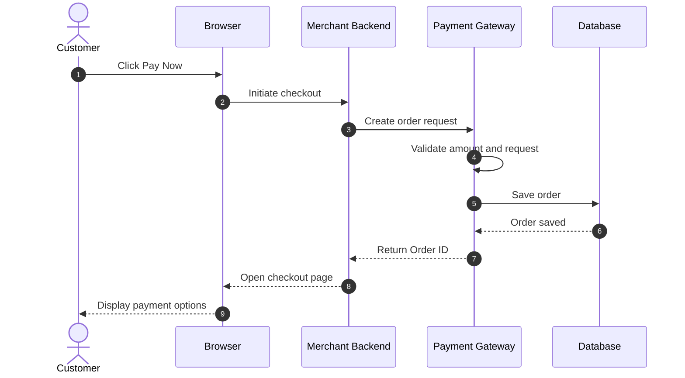
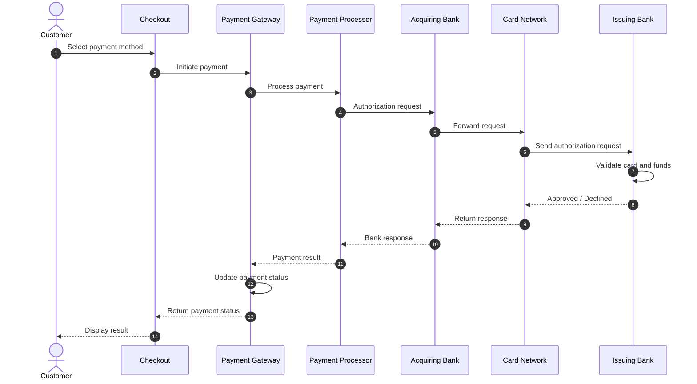
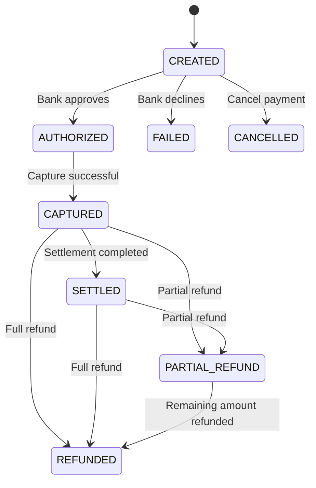
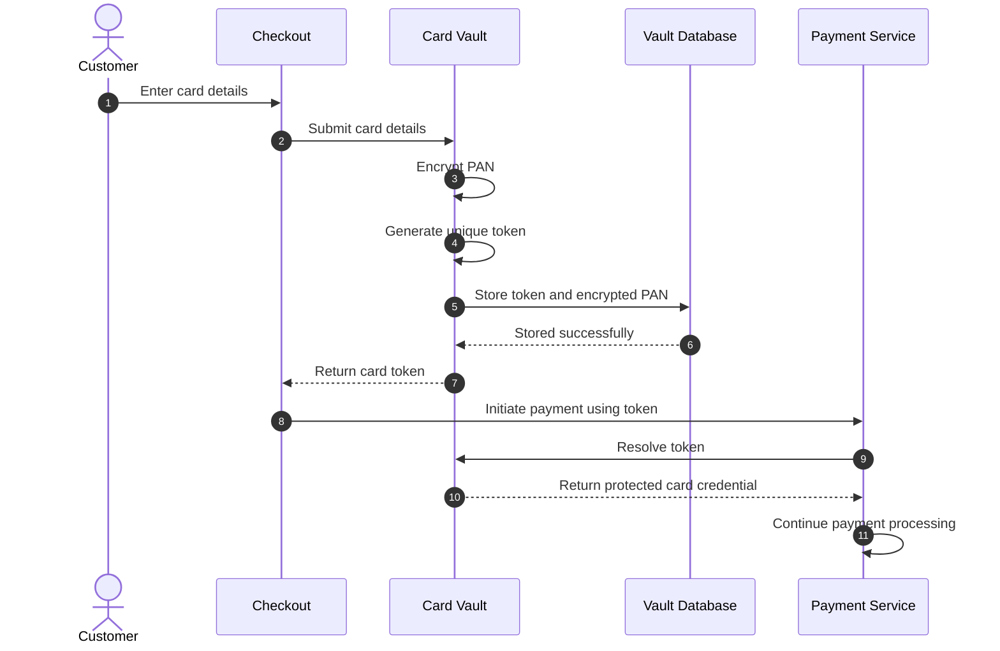
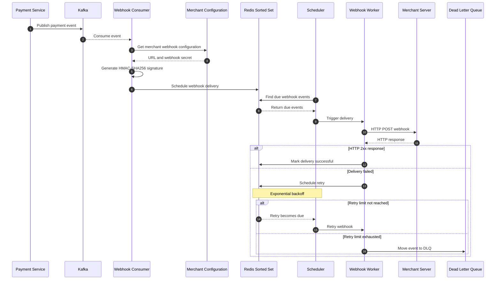
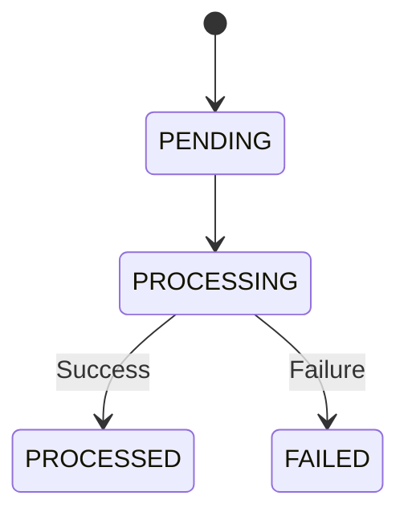
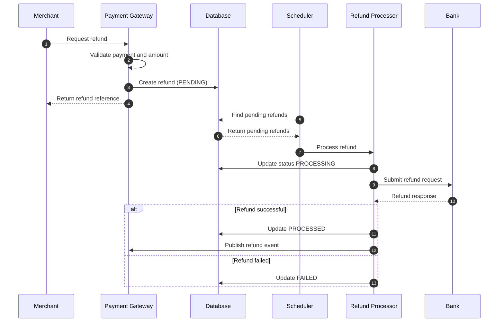
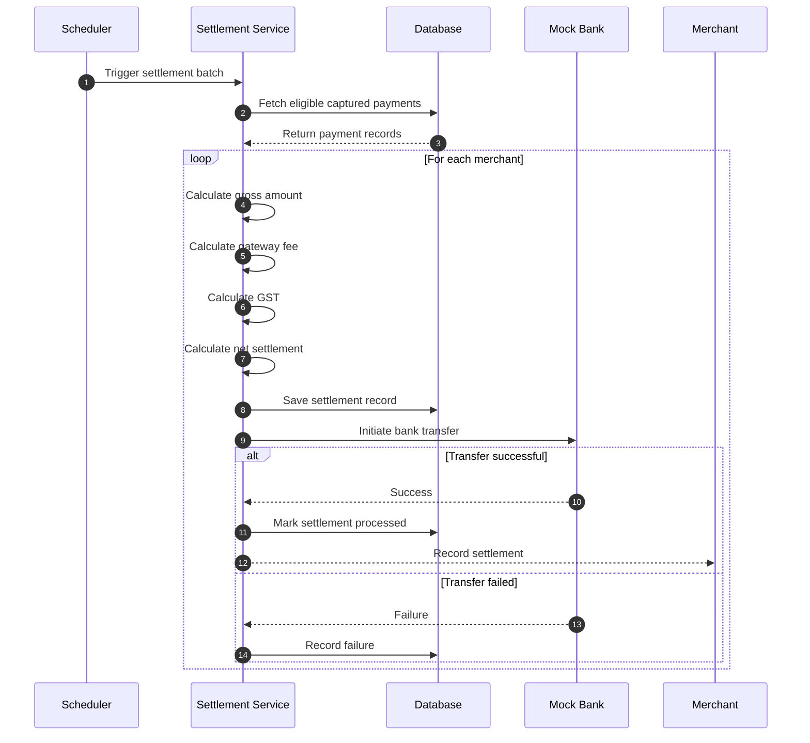
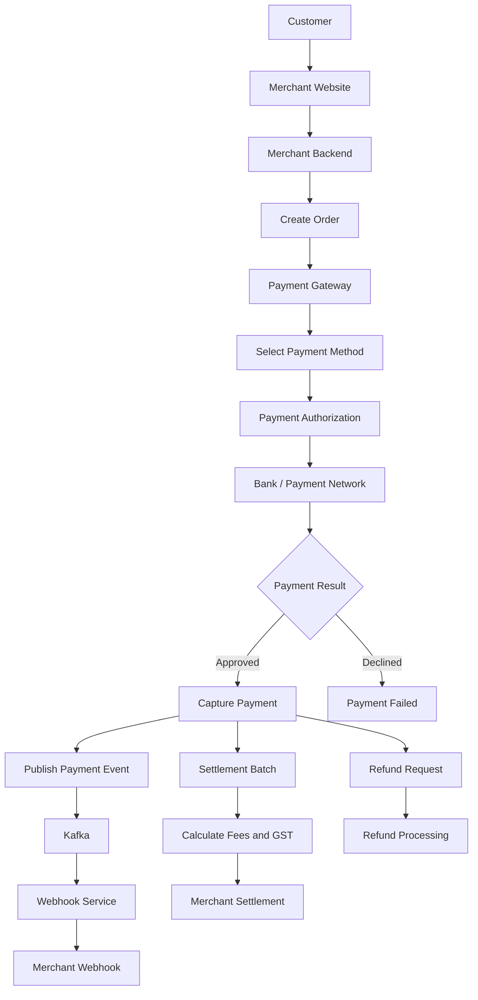

# Payment Gateway – Internal Working & Sequence Diagram Explanation

## 1. Project Overview

A Payment Gateway acts as a bridge between a merchant, customer, and banking infrastructure. It securely processes online payments, communicates with banks, manages payment status, handles refunds, and transfers funds to merchants through settlements.

This documentation explains the internal working of a payment gateway, including:

- Customer checkout and order creation
- Payment authorization
- Card tokenization and card vault
- Payment lifecycle and state transitions
- Webhook delivery and retry mechanism
- Refund processing
- Merchant settlement
- Merchant onboarding and authentication

---

## 2. Main Components

| Component | Responsibility |
|---|---|
| Customer | Initiates payment for a product or service. |
| Merchant | Business that accepts online payments. |
| Merchant Backend | Creates orders and communicates with the payment gateway. |
| Payment Gateway | Manages payment requests and coordinates payment processing. |
| Payment Processor | Handles payment authorization and processing. |
| Acquiring Bank | Processes payments on behalf of the merchant. |
| Card Network | Routes card transactions between acquiring and issuing banks. |
| Issuing Bank | Customer's bank that approves or declines the payment. |
| Card Vault | Securely stores encrypted card information and token mappings. |
| Webhook Service | Sends payment updates to merchant servers. |
| Settlement Service | Calculates and processes merchant settlements. |

---

# 3. Customer Checkout and Order Creation

## What happens?

The payment process starts when a customer clicks the Pay Now button on the merchant website.

The merchant backend communicates with the payment gateway and creates an order.

The gateway validates the request, saves the order, and returns an Order ID.

The customer is then redirected to the payment checkout page.

## Sequence Diagram



## Step-by-step explanation

1. Customer clicks Pay Now.
2. Browser sends a checkout request to the merchant backend.
3. Merchant backend sends an order creation request to the gateway.
4. Gateway validates the request and amount.
5. Gateway saves the order in the database.
6. Gateway generates a unique Order ID.
7. Gateway returns the Order ID to the merchant.
8. Merchant opens the checkout page for the customer.

### Important concepts

**Order ID:** A unique identifier used to track an order.

**Idempotency:** Prevents duplicate order creation when the same request is retried.

**Order Expiry:** The source design specifies a 15-minute order expiry.

**X-Idempotency-Key:** HTTP header used to identify repeated logical requests.

---

# 4. Payment Authorization Flow

## What happens?

After order creation, the customer selects a payment method such as:

- Credit Card
- Debit Card
- UPI Intent
- Net Banking

The payment gateway sends an authorization request through the payment processing infrastructure.

The issuing bank checks the transaction and returns an approval or decline response.

## Sequence Diagram



## Step-by-step explanation

1. Customer selects a payment method.
2. Checkout sends the payment request to the gateway.
3. Gateway forwards the request to the payment processor.
4. Acquiring bank receives the authorization request.
5. Card network routes the request to the issuing bank.
6. Issuing bank validates the card and available funds.
7. Issuing bank approves or declines the transaction.
8. Response travels back through the banking network.
9. Gateway updates the payment status.
10. Customer receives the payment result.

### Important concepts

**Authorization:** Issuing bank approves or declines the transaction.

**Capture:** Confirms that the authorized amount should be collected.

**Settlement:** Transfers the merchant's net proceeds through the settlement process.

Authorization, capture, and settlement are different stages.

---

# 5. Payment Lifecycle and State Machine

A payment moves through different states during its lifecycle.

## Payment States

| State | Explanation |
|---|---|
| CREATED | Payment request has been created. |
| AUTHORIZED | Bank has approved the transaction. |
| CAPTURED | Payment amount has been captured. |
| SETTLED | Settlement has been completed. |
| PARTIAL_REFUND | A portion of the payment has been refunded. |
| REFUNDED | Full payment amount has been refunded. |
| FAILED | Payment processing failed. |
| CANCELLED | Payment was cancelled. |

## State Diagram



### Why do we need a state machine?

A state machine ensures that payments move only through valid business transitions.

For example:

- CREATED → AUTHORIZED is valid.
- AUTHORIZED → CAPTURED is valid.
- CREATED → SETTLED should not happen directly.

It prevents invalid payment status updates and maintains transaction consistency.

---

# 6. Card Vault and Tokenization

## What is a Card Vault?

A Card Vault is a secure component responsible for storing sensitive card information.

Instead of exposing the original card number throughout the application, the system generates a token that represents the card.

**PAN** means Primary Account Number, which is the card number.

## Sequence Diagram



## Step-by-step explanation

1. Customer enters card details.
2. Checkout sends card details through a protected flow.
3. Card Vault receives the card information.
4. Vault encrypts the PAN.
5. Vault generates a unique token.
6. Vault stores the token-to-card mapping.
7. Vault returns the token to the checkout flow.
8. Payment service uses the token for payment processing.

### Why use tokenization?

- Reduces exposure of sensitive card information.
- Avoids repeatedly storing raw card numbers in business tables.
- Helps isolate sensitive data.
- Supports saved payment methods.

**Security note:** Encryption and tokenization alone do not guarantee PCI DSS compliance. Proper access control, encryption key management, audit logging, and secure handling of card data are also required. CVV must not be stored after authorization.

---

# 7. Webhook Delivery Architecture

## What is a Webhook?

A webhook is an HTTP callback sent by the payment gateway to the merchant whenever an important payment event occurs.

Examples:

- payment.captured
- payment.failed
- refund.processed

The merchant does not need to continuously ask the gateway for payment updates.

## Webhook Architecture



## Step-by-step explanation

### Step 1: Publish payment event

When payment processing is completed, the payment service publishes an event to Kafka.

Example:

```json
{
  "event": "payment.captured",
  "payment_id": "pay_12345",
  "amount": 100000,
  "currency": "INR"
}
```

### Step 2: Kafka Consumer

The webhook consumer reads the payment event from Kafka.

It identifies the merchant who should receive the notification.

### Step 3: Merchant configuration

The consumer retrieves:

- Webhook URL
- Webhook secret
- Event subscription configuration

### Step 4: Generate webhook signature

The system signs the payload using HMAC-SHA256.

```text
signature = HMAC_SHA256(webhook_secret, payload)
```

The merchant uses the shared secret to independently verify the signature.

### Step 5: Store delivery job in Redis

The webhook event is added to a Redis Sorted Set.

The score represents the scheduled delivery timestamp.

Example:

```text
webhook_101 -> 100000
webhook_102 -> 100060
webhook_103 -> 100300
```

### Step 6: Scheduler

The source design specifies a scheduler that runs every 5 seconds.

It checks Redis for events whose scheduled execution time has arrived.

### Step 7: Webhook delivery

The worker sends an HTTP POST request to the merchant's webhook URL.

### Step 8: Successful response

If the merchant returns HTTP 2xx, the event is marked as successfully delivered.

### Step 9: Retry mechanism

If the merchant returns an error or the request times out, the system schedules another delivery.

The source describes this retry schedule:

| Retry | Delay |
|---|---|
| Initial attempt | Immediate |
| Retry 1 | 1 minute |
| Retry 2 | 5 minutes |
| Retry 3 | 30 minutes |
| Retry 4 | 2 hours |
| Retry 5 | 8 hours |
| Retry 6 | 24 hours |

The source specifies a 7-attempt policy. Confirm whether this means seven total attempts or seven retries after the initial attempt in the implementation.

### Step 10: Dead Letter Queue

If the configured retry limit is exhausted, the event moves to the Dead Letter Queue.

The DLQ allows developers or operations teams to investigate and replay failed events.

## Why use Kafka and Redis together?

| Kafka | Redis |
|---|---|
| Stores and distributes payment events. | Schedules webhook delivery. |
| Supports asynchronous consumers. | Supports time-based job retrieval. |
| Decouples payment processing from notifications. | Helps manage retry timing. |
| Supports event-driven architecture. | Supports fast scheduling operations. |

---

# 8. Refund Processing

## What is a Refund?

A refund means returning all or part of a captured payment amount to the customer.

There are two types:

1. Full Refund
2. Partial Refund

The source describes asynchronous refund processing.

## Refund State Machine



## Refund Sequence Diagram



## Explanation

1. Merchant requests a refund.
2. Gateway validates the payment.
3. Gateway checks the refundable amount.
4. Refund record is created with PENDING status.
5. Scheduler picks the pending refund.
6. Refund processor submits the request.
7. Bank or payment rail returns a result.
8. Refund status changes to PROCESSED or FAILED.

### Important interview point

The total of successful refunds must never exceed the captured amount.

For concurrent refund requests, this validation must be protected by suitable database transactions or concurrency controls.

---

# 9. Merchant Settlement

## What is Settlement?

Settlement is the process of transferring the merchant's net payment amount after deducting applicable fees and taxes.

The source design describes a nightly settlement batch at 11 PM, configurable by the application.

## Settlement Sequence Diagram



## Settlement Calculation

The source specifies:

- Gateway fee: 2% of captured amount.
- GST: 18% of gateway fee.

Example:

```text
Gross captured amount = ₹10,000

Gateway fee (2%) = ₹200

GST (18% of fee) = ₹36

Net settlement = Gross - Fee - GST

Net settlement = 10,000 - 200 - 36

Net settlement = ₹9,764
```

### Why process settlements merchant by merchant?

Suppose 100 merchants are included in a settlement batch.

If one merchant's bank transfer fails, the remaining 99 merchants should still be processed.

This is called per-merchant failure isolation.

---

# 10. Merchant Onboarding and Authentication

The source design describes the following onboarding process:

1. Merchant signs up.
2. Merchant provides business and KYC details.
3. Merchant logs in using email and password.
4. Password is stored using BCrypt hashing.
5. API credentials are generated.
6. API secret is displayed only once.

## Authentication Methods

| Authentication | Purpose |
|---|---|
| API Key | Merchant server-to-server API authentication. |
| JWT | Dashboard user authentication. |
| BCrypt | Secure password hashing. |
| Rate Limiting | Protects the gateway from excessive requests. |

### Why BCrypt?

BCrypt is a password hashing algorithm.

It is designed to make password guessing more expensive and does not allow the original password to be decrypted.

### Why Rate Limiting?

Rate limiting controls how many requests a merchant can send within a specified time window.

It protects the payment gateway from excessive traffic and misbehaving clients.

---

# 11. Complete Payment Gateway Workflow

The following diagram summarizes the major workflows.



---

# 12. Important Technical Concepts

| Concept | Simple Explanation |
|---|---|
| Idempotency | Prevents duplicate business operations when requests are retried. |
| Kafka | Distributed event streaming platform used for asynchronous communication. |
| Redis | In-memory data store used for caching, rate limiting, and scheduling. |
| HMAC-SHA256 | Generates a signature to verify webhook authenticity and integrity. |
| DLQ | Stores events that fail after the configured retry policy. |
| Tokenization | Replaces sensitive card data with a token. |
| State Machine | Controls valid payment status transitions. |
| Exponential Backoff | Increases the waiting time between retry attempts. |
| Authorization | Bank approval or decline of a payment request. |
| Capture | Confirms the amount to be collected. |
| Settlement | Transfers the merchant's net proceeds. |
| Webhook | HTTP notification sent to a merchant when an event occurs. |

---

# 13. Interview Questions and Answers

### Q1. What is a Payment Gateway?

A payment gateway is a platform that connects merchants with payment processing and banking infrastructure. It securely handles payment requests, authorization, transaction status, refunds, and settlement workflows.

### Q2. What is the difference between Order and Payment?

An order represents the merchant's request to collect a specific amount.

A payment represents an actual attempt to pay for that order.

One order can have multiple payment attempts, depending on the business rules.

### Q3. What is the difference between Authorization and Capture?

Authorization checks whether the issuing bank approves the payment.

Capture confirms that the authorized amount should be collected.

### Q4. Why do we use Kafka?

Kafka allows services to communicate asynchronously through events.

For example, after a payment is captured, the payment service publishes an event. The webhook service consumes that event and notifies the merchant.

This avoids making payment processing depend on the merchant's server response.

### Q5. Why do we use Redis for Webhook Scheduling?

Redis Sorted Sets store data in sorted order using scores.

We can use timestamps as scores to identify which webhook jobs are ready for delivery.

### Q6. What happens when a webhook fails?

The system schedules another attempt using exponential backoff.

If all configured attempts fail, the event is moved to the Dead Letter Queue for investigation or replay.

### Q7. Why do we need HMAC-SHA256?

It allows the merchant to verify that the webhook payload was signed using the shared secret and has not been modified.

### Q8. What is a DLQ?

A Dead Letter Queue stores messages that could not be processed successfully after the configured retry policy.

It helps with debugging and controlled replay.

### Q9. Why do we use a Card Vault?

A card vault securely stores encrypted card information and provides tokens to other application components.

It reduces the exposure of raw card data.

### Q10. Why is settlement asynchronous?

Settlement can involve multiple merchants, calculations, and external banking operations.

Processing it asynchronously allows payment processing to remain independent of settlement execution.

### Q11. What happens if a merchant server is down?

The gateway can continue processing the payment and store the webhook delivery for retry.

The notification can be delivered when the merchant server becomes available.

### Q12. Why do we need a Payment State Machine?

It ensures that payment status transitions follow valid business rules and prevents inconsistent transaction states.

### Q13. How do you prevent duplicate refunds?

Use idempotency keys, transactional validation, and concurrency controls to ensure that concurrent refund requests do not exceed the captured amount.

### Q14. Is a successful browser redirect sufficient to confirm payment?

No. The merchant backend should verify the payment through a trusted server-side API or a validated webhook.

### Q15. What happens if a webhook worker crashes after sending a request?

The merchant may have received the webhook even though the gateway did not record the acknowledgement.

The gateway may retry the same event. Therefore, merchants should implement idempotent webhook processing using stable event IDs.

---

# 14. Two-Minute Interview Explanation

"I worked on understanding and designing the internal workflow of a payment gateway.

The process starts when a customer clicks Pay Now on the merchant website. The merchant backend creates an order through the payment gateway and receives a unique Order ID.

After that, the customer selects a payment method, and the gateway initiates payment authorization through the payment processor and banking network.

The issuing bank validates the transaction and returns an approval or decline response. Based on the response, the gateway updates the payment status.

For card security, the architecture includes a Card Vault that encrypts card information and generates tokens. This helps reduce the exposure of sensitive card details.

For asynchronous communication, the system uses Kafka for payment events. A webhook consumer reads the event, retrieves the merchant configuration, signs the payload using HMAC-SHA256, and schedules delivery through Redis.

A scheduler checks for due webhook events, and a worker sends HTTP requests to merchant servers. If delivery fails, the system retries using exponential backoff. After the configured retry limit, the event moves to a Dead Letter Queue.

The architecture also supports full and partial refunds and scheduled merchant settlements with fee and GST calculations.

Overall, the design demonstrates payment processing, event-driven architecture, asynchronous communication, security, and distributed-system concepts."

---

# 15. Important Implementation Checks

Before presenting this architecture as a fully implemented production system, verify these details in the actual code:

1. Is the retry policy seven total attempts or seven retries?
2. Are Redis webhook jobs claimed atomically across multiple workers?
3. Can a worker crash without losing a scheduled webhook?
4. Does the merchant verify the HMAC signature against the raw request body?
5. Are webhook event IDs used for duplicate detection?
6. Are payment and refund operations protected against concurrent duplicate requests?
7. Are all payment state transitions validated?
8. Is card encryption key management properly implemented?
9. Are monetary calculations performed in integer minor units such as paise?
10. Is the bank integration real or simulated?

These are particularly important topics for backend developer interviews.

---

# 16. Final Summary

The payment gateway architecture covers the complete payment lifecycle:

1. Merchant onboarding and authentication.
2. Customer checkout and order creation.
3. Payment authorization through banking infrastructure.
4. Card tokenization and secure storage.
5. Payment state management.
6. Kafka-based asynchronous event processing.
7. Redis-based webhook scheduling.
8. HMAC-SHA256 signature verification.
9. Retry mechanism and Dead Letter Queue.
10. Full and partial refund processing.
11. Merchant settlement and fee calculation.

**One-line interview summary:**

A payment gateway securely connects merchants with banking infrastructure, manages order and payment lifecycles, processes authorization and capture, protects card information through tokenization, sends asynchronous webhook notifications, and manages refunds and merchant settlements.
